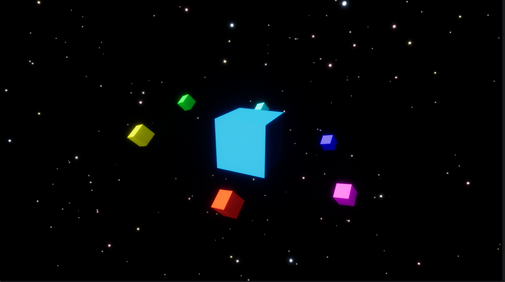

# Cube en orbite — POC Unreal Engine 5

Petite preuve de concept en **C++ pur** sous **Unreal Engine 5.7** (Linux) : un cube lumineux au centre d'un ciel étoilé, entouré de petits cubes en orbite dont les couleurs défilent en dégradé. Aucun asset ni Blueprint : toute la scène, le menu et les contrôles sont construits dans le code.



## Aperçu

| Menu d'accueil | Simulation |
| :---: | :---: |
|  |  |

- **Menu d'accueil** (Slate) avec les boutons *Start* et *Quitter*, affiché par-dessus le ciel étoilé.
- **Cube central** coloré, qui change de teinte à chaque clic (toujours bien différente de la précédente).
- **6 petits cubes en orbite** autour du centre, avec un dégradé de couleurs qui tourne en continu.
- **Ciel de 1 500 étoiles** générées aléatoirement.
- **Caméra orbitale** qui tourne autour du cube en suivant la souris (horizontalement).
- Éclairage principal + lumière d'appoint qui suit la caméra pour éviter les faces noires.

## Contrôles

| Touche / action | Effet |
| --- | --- |
| Déplacer la souris | Fait tourner la caméra autour du cube |
| Clic gauche | Nouvelle couleur pour le cube central |
| Flèches ← → ↑ ↓ | Déplacent le centre des orbites |
| Espace / Échap | Retour au menu |
| Bouton *Quitter* | Ferme le jeu |

## Prérequis

- Linux
- Unreal Engine **5.7** compilé depuis les sources (par défaut dans `~/Bureau/UnrealEngine`, modifiable via la variable `UE_ROOT`)

## Lancer le projet

```bash
# Lance le jeu directement, sans ouvrir l'éditeur
./lancer.sh

# Recompile le C++ avant de lancer
./lancer.sh --build

# Avec un autre emplacement pour Unreal Engine
UE_ROOT=/chemin/vers/UnrealEngine ./lancer.sh
```

Pour produire un **exécutable autonome** (build + cook + package dans `Build/Packaged`) puis le lancer :

```bash
./lancer_exe.sh
```

Le jeu s'ouvre en fenêtre 1280×720.

## Structure du code

```
Source/PocUnreal/
├── OrbitGameMode.*   # Game mode : utilise OrbitPawn comme pawn par défaut
├── OrbitPawn.*       # Scène : cube, satellites, étoiles, lumières, caméra et contrôles
├── SOrbitMenu.*      # Menu d'accueil Slate (titre + Start / Quitter)
└── PocUnreal.*       # Module du jeu
```

Quelques paramètres sont réglables directement dans `OrbitPawn.h` :

| Paramètre | Défaut | Rôle |
| --- | --- | --- |
| `SatelliteCount` | 6 | Nombre de petits cubes en orbite |
| `SatelliteRadius` | 200 | Rayon de l'orbite |
| `SatelliteSpeed` | 30 °/s | Vitesse de rotation des satellites |
| `OrbitShiftStep` | 15 | Déplacement du centre des orbites par appui sur une flèche |
| `ColorCycleSeconds` | 8 s | Durée d'un tour complet du dégradé |
| `Sensitivity` | 0,3 °/px | Sensibilité de la caméra à la souris |
| `StarCount` | 1500 | Nombre d'étoiles |
