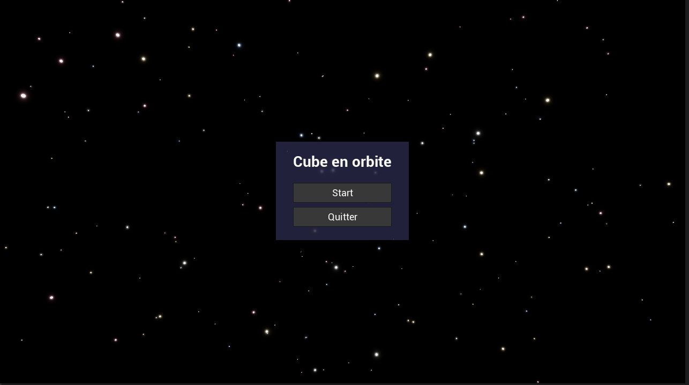

# Cube en orbite — Unreal Engine 5 POC

A small proof of concept written in **pure C++** with **Unreal Engine 5.7** (Linux): a glowing cube in the middle of a starry sky, surrounded by small orbiting cubes whose colors cycle through a gradient. No assets and no Blueprints: the scene, the menu and the controls are all built in code.


## Overview

| Start menu | Simulation |
| :---: | :---: |
|  |  |

- **Start menu** (Slate) with *Start* and *Quitter* (quit) buttons, shown over the starry sky.
- **Central cube** that changes hue on every click (always clearly different from the previous one).
- **6 small cubes orbiting** the center, with a color gradient that keeps cycling.
- **Sky of 1,500 stars**, randomly generated.
- **Orbit camera** that turns around the cube following the mouse (horizontally).
- Main light + fill light that follows the camera, so no face is ever fully black.

## Controls

| Key / action | Effect |
| --- | --- |
| Move the mouse | Rotates the camera around the cube |
| Left click | New color for the central cube |
| Arrow keys ← → ↑ ↓ | Move the orbit center |
| Space / Escape | Back to the menu |
| *Quitter* button | Closes the game |

## Requirements

- Linux
- Unreal Engine **5.7** built from source (defaults to `~/Bureau/UnrealEngine`, override with the `UE_ROOT` variable)

## Running the project

```bash
# Run the game directly, without opening the editor
./lancer.sh

# Rebuild the C++ before running
./lancer.sh --build

# With Unreal Engine installed elsewhere
UE_ROOT=/path/to/UnrealEngine ./lancer.sh
```

To produce a **standalone executable** (build + cook + package into `Build/Packaged`) and run it:

```bash
./lancer_exe.sh
```

The game opens in a 1280×720 window.

## Code structure

```
Source/PocUnreal/
├── OrbitGameMode.*   # Game mode: uses OrbitPawn as the default pawn
├── OrbitPawn.*       # Scene: cube, satellites, stars, lights, camera and controls
├── SOrbitMenu.*      # Slate start menu (title + Start / Quitter)
└── PocUnreal.*       # Game module
```

A few parameters can be tweaked directly in `OrbitPawn.h`:

| Parameter | Default | Purpose |
| --- | --- | --- |
| `SatelliteCount` | 6 | Number of small orbiting cubes |
| `SatelliteRadius` | 200 | Orbit radius |
| `SatelliteSpeed` | 30 °/s | Satellite rotation speed |
| `OrbitShiftStep` | 15 | Orbit center offset per arrow key press |
| `ColorCycleSeconds` | 8 s | Duration of a full gradient cycle |
| `Sensitivity` | 0.3 °/px | Camera mouse sensitivity |
| `StarCount` | 1500 | Number of stars |
